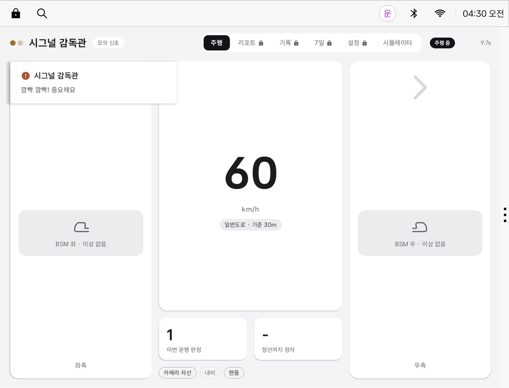
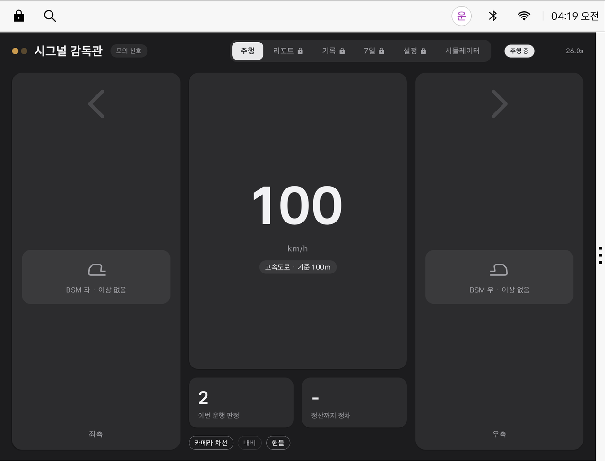
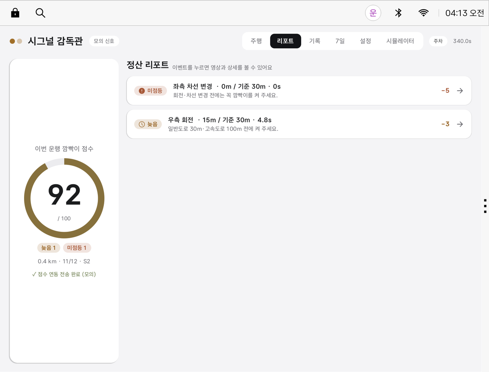
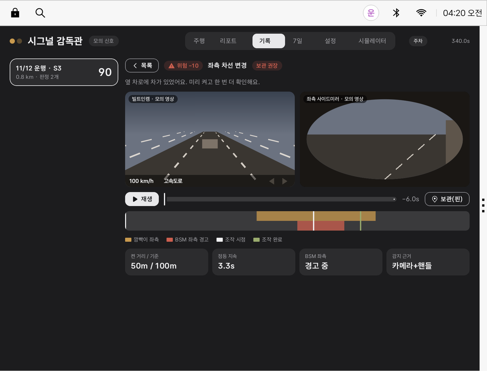
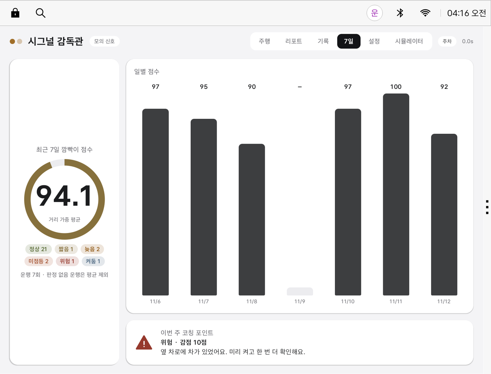
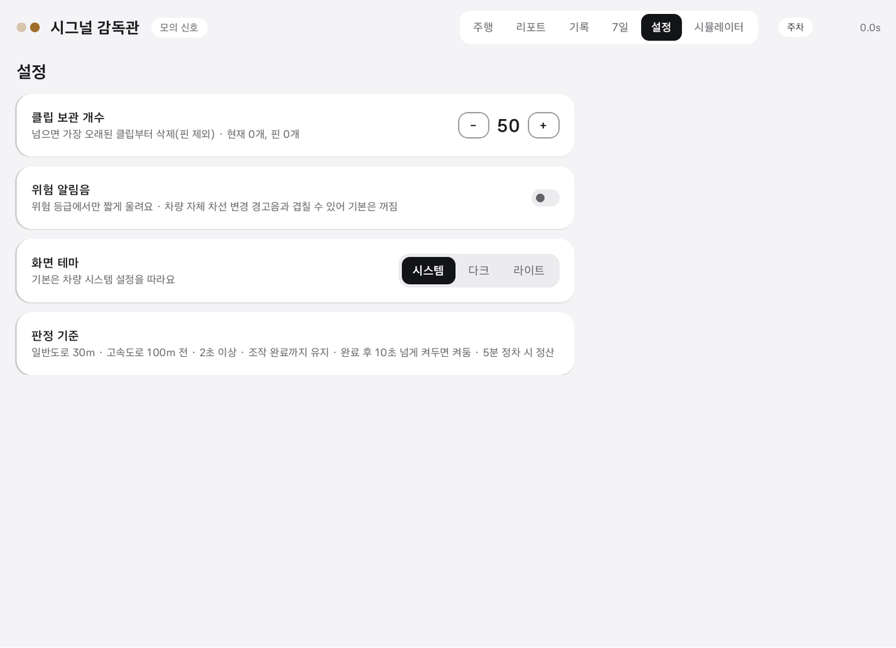
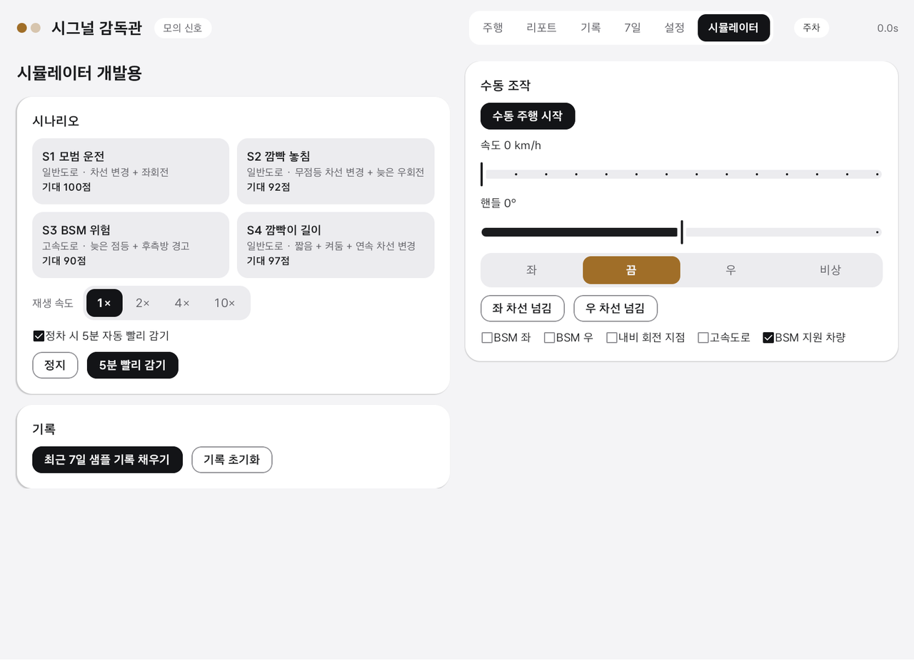

# 시그널 감독관 · 0.1.0_1

**팀 이제뭐하조** · Pleos Connect(Android Automotive)용 방향지시등 습관 코칭 앱

> 한 줄 소개: 회전·차선 변경 때 깜빡이를 제때·충분히·알맞게 켰는지 판정하고, 운행이 끝나면 100점 만점 "깜빡이 점수"로 정산해 주는 차량용 코칭 앱입니다.

## APK 내려받기

매 릴리스마다 **에뮬레이터용**과 **실차 테스트용** 두 가지를 함께 올립니다. 패키지가 달라 한 기기에 둘 다 설치할 수 있습니다.

| 파일 | 용도 | 패키지 | 차량 신호 |
|---|---|---|---|
| [`apk/이제뭐하조_시그널감독관_release.apk`](apk/이제뭐하조_시그널감독관_release.apk) | **실차 테스트용** (공모전 제출용) | `dev.ijemwohajo.signalsupervisor` | 깜빡이·핸들 각도·기어는 Pleos Vehicle SDK 실제 값. 차속·BSM·카메라·내비는 추후 지원 예정이라 모의 값으로 보충 |
| [`apk/이제뭐하조_시그널감독관_에뮬레이터_release.apk`](apk/이제뭐하조_시그널감독관_에뮬레이터_release.apk) | **에뮬레이터 시연용** | `dev.ijemwohajo.signalsupervisor.emu` | 모두 모의 값. 시뮬레이터 탭으로 시나리오·수동 조작 |

같은 파일은 [GitHub Releases](https://github.com/songtan-ajae/SignalSupervisor/releases)에도 올립니다.

## 테스트 환경

| 항목 | 값 |
|---|---|
| Pleos Connect 에뮬레이터 | `Pleos_Connect_API34` · 이미지 `release_connect_v2.1.0` (Android 14, API 34, x86_64) |
| 화면 규격 | 2560 × 1440, 160 dpi · 앱 창 1682 × 1210 (오른쪽 앱 영역) |
| 설치 사용자 | 운전자 사용자 `user 10` |
| Pleos Vehicle SDK | `ai.pleos.playground:Vehicle:2.3.2` (실차 테스트용만) |
| 필요한 권한 | 알림(`POST_NOTIFICATIONS`), 실차용은 `pleos.car.permission.CAR_LIGHTS`·`CAR_DRIVE` |

회전하거나 차선을 바꿀 때 깜빡이를 **제때, 충분히, 알맞은 길이로** 켰는지 판정해 운전자에게 알려 주는 앱입니다. 운행이 끝나고 5분 이상 정차하면 **100점 만점의 "깜빡이 점수"** 를 정산합니다. 깜빡이를 넣어야 했던 순간에는 빌트인캠·사이드미러 영상과 BSM(후측방 경고) 상태를 함께 기록해 두므로, 나중에 그때 주변 상황을 다시 볼 수 있습니다.

> **모의 데이터 고지**: Pleos 공개 SDK에는 차속·BSM·카메라·내비 회전 지점 API가 없어 이 값들은 **모의 값**입니다(추후 지원 예정). 실차 테스트용 빌드는 깜빡이·핸들 각도·기어만 실제 값을 받고, 차속은 D단이면 30 km/h로 가정합니다. 에뮬레이터용은 모든 신호가 모의 값입니다. 카메라 영상과 현대차·기아 운전 점수 연동도 모의이며, 차량을 제어하지 않습니다.



---

## 주요 기능

| 기능 | 설명 |
|---|---|
| **실시간 판정** | 회전·차선 변경마다 깜빡이를 켠 거리, 점등 시간, 끈 시점을 판정합니다. |
| **알림 카드** | 앱이 화면에 있을 때만 Pleos 시스템 알림 카드 모양으로 짧게 알려 줍니다. 음성은 쓰지 않습니다. 앱이 화면에 없으면 기록만 합니다. |
| **BSM 기록** | 조작 시점에 후측방 경고가 켜져 있었는지 기록하고, 위험했으면 "위험" 등급으로 판정합니다. |
| **전후 클립** | 판정 시점 앞뒤의 빌트인캠·사이드미러 짧은 영상(모의)을 저장합니다. 개수를 넘으면 오래된 것부터 지웁니다(FIFO). 핀으로 고정한 클립은 지우지 않습니다. |
| **운행 정산** | 5분 이상 정차하면 운행을 마감하고 100점에서 감점해 점수를 냅니다. 결과는 Pleos 알림 센터에도 남깁니다. |
| **7일 리포트** | 최근 7일 점수를 거리 가중 평균으로 보여 주고, 가장 자주 나온 문제를 코칭 포인트로 짚어 줍니다. |
| **주행 중 잠금** | 주행 중에는 리포트·기록·설정 탭을 잠가 운전에 집중하게 합니다. |
| **다크/라이트 테마** | 기본은 차량 시스템 설정을 따릅니다. |

## 판정 기준

기준은 도로교통법을 참고했습니다(`core/JudgeConfig.kt`).

| 항목 | 기준 |
|---|---|
| 미리 켜는 거리 | 일반도로 **30 m** 전, 고속도로 **100 m** 전 |
| 최소 점등 시간 | **2초** 이상, 조작이 끝날 때까지 유지 |
| 켜둠 | 조작이 끝난 뒤 **10초** 넘게 켜 두면 "켜둠" |
| 조작 감지 | 카메라 차선 넘김 > 내비 회전 지점 > 핸들 각도 순으로 결합해 판단 |
| 정산 | 운행 후 **5분 이상 정차**하면 정산 |

| 등급 | 뜻 | 감점 |
|---|---|---|
| 정상 | 기준을 모두 지킴 | 0 |
| 켜둠 | 조작 후 너무 오래 켜 둠 | −1 |
| 짧음 | 2초 미만으로 켰거나 조작 중 끔 | −2 |
| 늦음 | 기준 거리보다 늦게 켬 | −3 |
| 미점등 | 켜지 않음 | −5 |
| 위험 | 정상이 아닌데(미점등·늦음·짧음) 조작 시점에 그 방향 BSM 경고가 켜져 있었음 | −10 |

정상으로 켰더라도 BSM 경고가 켜져 있었으면 감점 없이 "주의" 메모를 남깁니다.

## 화면

### 주행 (다크)
속도, 도로 종류별 기준 거리, 좌우 BSM 상태, 이번 운행 판정 수, 감지 근거(카메라 차선·내비·핸들)를 보여 줍니다.



### 정산 리포트
운행 점수와 등급별 개수, 감점된 이벤트 목록을 보여 줍니다. 이벤트를 누르면 영상과 상세가 열립니다.



### 기록 · 클립 상세
빌트인캠과 사이드미러 영상(모의), 깜빡이·BSM·조작 타임라인, 켠 거리, 점등 시간, BSM 상태, 감지 근거를 한 화면에서 확인합니다. 중요한 클립은 핀으로 보관할 수 있습니다.



### 최근 7일
일별 점수와 거리 가중 평균, 등급별 횟수, 이번 주 코칭 포인트를 보여 줍니다.



### 설정
클립 보관 개수, 위험 알림음(차량 자체 경고음과 겹치지 않도록 기본은 꺼짐), 화면 테마를 바꿀 수 있습니다.



### 시뮬레이터 (개발용 · 에뮬레이터용 빌드에만 있음)
실제 차량 신호가 없으므로 시나리오 재생과 수동 조작으로 앱을 시험합니다. 재생 속도, 정차 5분 자동 빨리 감기, 7일 샘플 기록 채우기를 지원합니다.



| # | 시나리오 | 내용 | 기대 점수 |
|---|---|---|---|
| S1 | 모범 운전 | 일반도로 · 차선 변경 + 좌회전 | 100 |
| S2 | 깜빡 놓침 | 일반도로 · 무점등 차선 변경 + 늦은 우회전 | 92 |
| S3 | BSM 위험 | 고속도로 · 늦은 점등 + 후측방 경고 | 90 |
| S4 | 깜빡이 길이 | 일반도로 · 짧음 + 켜둠 + 연속 차선 변경 | 97 |

"최근 7일 샘플 기록 채우기"의 7일 점수는 **94.1**입니다. 기대값은 `shared/scenarios.json`에 있고 단위 테스트로 검증합니다.

---

## 빌드

### 요구 사항
- JDK 17
- Android SDK (compileSdk 37 플랫폼, 빌드 도구)
- Gradle 9.3.1 래퍼 포함 · AGP 9.1.0 · Kotlin 2.2.10 · Jetpack Compose
- 앱: minSdk 28, targetSdk 34
- 실차 테스트용은 Pleos Maven 저장소(`https://nexus-playground.pleos.ai/repository/maven-releases/`)에서 Vehicle SDK를 받습니다. `settings.gradle`에 등록돼 있습니다.

### 빌드 종류

| 빌드 | Gradle 이름 | 다른 점 |
|---|---|---|
| 에뮬레이터 시연용 | `emu` | 패키지 끝에 `.emu`, 앱 이름 "시그널 감독관 (에뮬)", 시뮬레이터 탭 있음, 차량 신호 전부 모의 |
| 실차 테스트용 | `car` | Pleos Vehicle SDK로 깜빡이·핸들 각도·기어를 받음, 시뮬레이터 탭 숨김, 차속·BSM·카메라·내비는 "추후 지원 예정" 표시 후 모의 값 |

### 명령

Windows(Git Bash) 기준입니다.

```bash
export JAVA_HOME="<JDK 17 경로>"
export ANDROID_HOME="<Android SDK 경로>"
cd android
./gradlew testEmuDebugUnitTest testCarDebugUnitTest assembleEmuRelease assembleCarRelease
```

결과물은 `android/app/build/outputs/apk/emu/release/app-emu-release.apk`와 `android/app/build/outputs/apk/car/release/app-car-release.apk`입니다. 저장소의 `apk/` 폴더에는 이것을 공모전 규칙에 맞는 이름(`팀명_앱이름_release.apk`)으로 바꿔 올립니다.

### 릴리스 서명 (선택)

`android/keystore.properties`가 있을 때만 서명이 적용됩니다. 없으면 서명 없는 release APK가 나옵니다. `*.jks`와 `keystore.properties`는 커밋하지 마세요.

```properties
storeFile=signal-release.jks
storePassword=<비밀번호>
keyAlias=signal
keyPassword=<비밀번호>
```

### Pleos 에뮬레이터에 설치·실행

운전자 사용자(user 10)에 설치합니다. 두 APK를 함께 설치해도 됩니다.

```bash
adb install -r --user 10 apk/이제뭐하조_시그널감독관_release.apk
adb install -r --user 10 apk/이제뭐하조_시그널감독관_에뮬레이터_release.apk
```

```bash
adb shell am start --user 10 -n dev.ijemwohajo.signalsupervisor/.MainActivity
```

```bash
adb shell am start --user 10 -n dev.ijemwohajo.signalsupervisor.emu/dev.ijemwohajo.signalsupervisor.MainActivity
```

처음 실행하면 알림 권한을 묻습니다. 정산 결과를 알림 센터에 남기려면 허용하세요.

- **에뮬레이터용 시연**: "시뮬레이터" 탭에서 S1~S4 시나리오를 누르면 주행·판정·정산이 자동으로 진행됩니다.
- **실차 테스트용 시연**: Pleos Virtual Console이나 실제 차량에서 깜빡이·핸들·기어를 바꾸면 반영됩니다. D단이면 30 km/h로 주행 중이라고 가정하고, P단으로 5분 이상 있으면 정산합니다.

### 아이콘

Pleos 아이콘은 현대자동차그룹 소유 리소스(Pleos Playground 이용약관 제10조·제12조)라 이 저장소와 APK에 넣지 않았습니다. 앱과 스크린샷은 모두 `android/app/fallback-icons`의 직접 만든 대체 아이콘을 씁니다.

### 모서리 R값

모든 화면의 모서리 둥글기는 4단계 토큰(`Corner.XS·S·M·L`, `ui/theme/Theme.kt`)만 씁니다. 겹친 요소는 "안쪽 R = 바깥 R − 안쪽 여백" 규칙으로 맞춥니다.

## 폴더 구성

| 경로 | 내용 |
|---|---|
| `apk/` | 릴리스 APK 2종 (실차 테스트용, 에뮬레이터용) |
| `android/app/src/main/java/.../core/` | 판정 엔진(`TripRecorder`), 기준(`JudgeConfig`), 점수, 클립 저장소, 시나리오 재생 |
| `android/app/src/main/java/.../source/` | 차량·내비·카메라 신호 어댑터 인터페이스 |
| `android/app/src/car/` | 실차 테스트용 Pleos SDK 연결(`VehicleBridge`)과 차량 권한 |
| `android/app/src/emu/` | 에뮬레이터용 빈 연결 |
| `android/app/src/main/java/.../app/` | 앱 상태(`AppGraph`), 저장(`TripRepository`), 정산 알림 |
| `android/app/src/main/java/.../ui/` | Compose 화면 |
| `android/app/src/test/` | 단위 테스트 39개 |
| `android/app/fallback-icons/` | 대체 아이콘 |
| `shared/scenarios.json` | 시나리오·기대값 (앱 assets와 테스트가 공유) |
